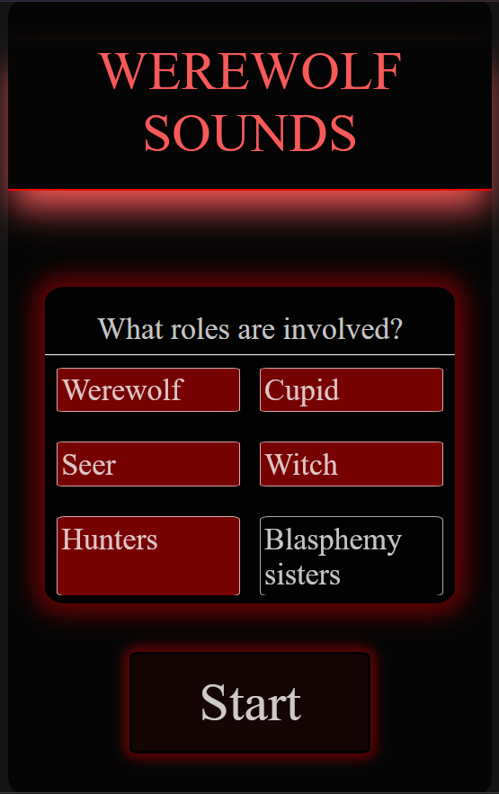
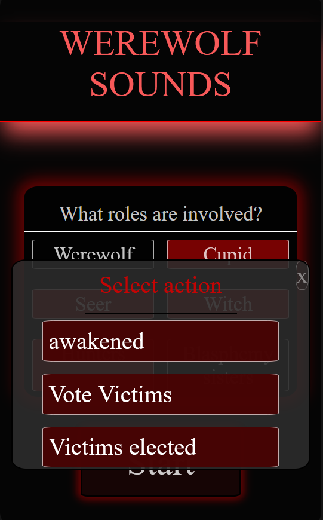
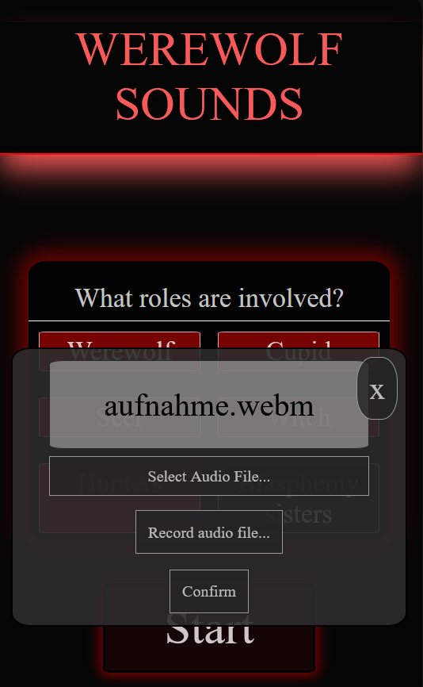
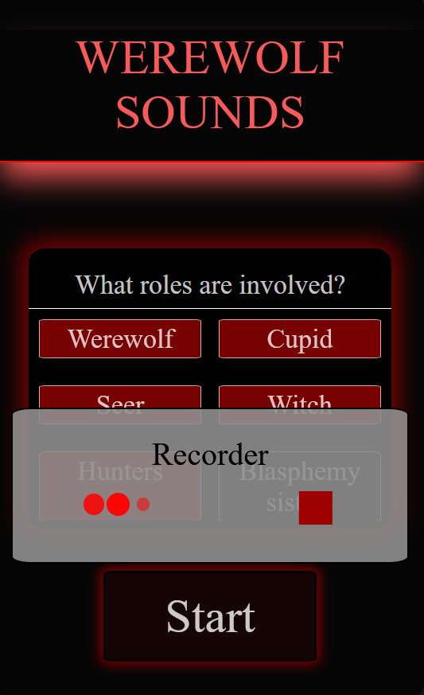
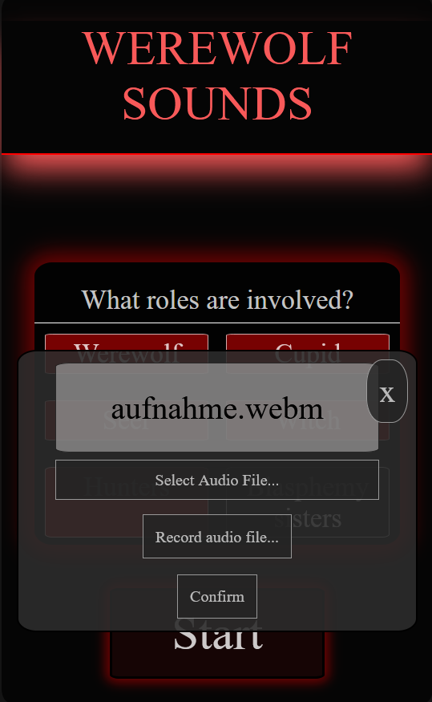
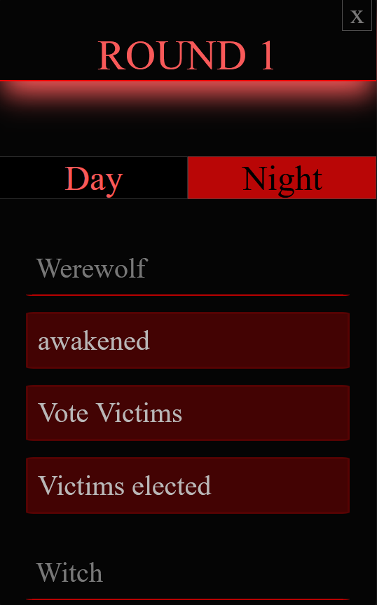

# werewolfGameSounds

A website where you can record or play sounds for the werewolf game. 

# Why I developed it

For my birthday I want to play the werewolf game in a great round, but we played it already many times, so I'm developing this website to give the game a little more flavour, whit these funny sounds. 
I already uploaded some test sounds, but they do not match the theme - it was just testing.

# How does it work?

It's very simple! On the Landing Page you choose the roles that are in the game and then click start. 

In this version you can also upload your sounds for the different roles. Therefore you press the buttons for a longer time (not just clicking - clicking is still for selection). Then you will see that menu, were you can select the action for which you want to upload a sound:

After that the File Select Menu will open, where you can either upload one from your device or record a new audio:

If you choose to record this bar will open and record you until you hit the stop button:

After you recorded or selected a file you can listen to it when you click in the window, where now it's name is written. And finally you can upload the file by clicking Confirm:

When you have uploaded as many files as you want you can click play and get to the GameScreen.

On the Game Screen you will then see two areas: Day and Night. You can select them and when you toggle between them you will notice the Rounds are counting. On the Day Screen you habe sounds that are used at Day: 

 At the Night Screen sounds you need at night.
 

*The game is still in development so at the moment all sounds you upload are saved in my database and I basically own them, I will change that soon. Therefore I will add game groups*

# How to run it

It's a website, so you could just click that link: 

[wereWolfGame](https://nelebohn07012010-ship-it.github.io/werewolfGameSounds/)
