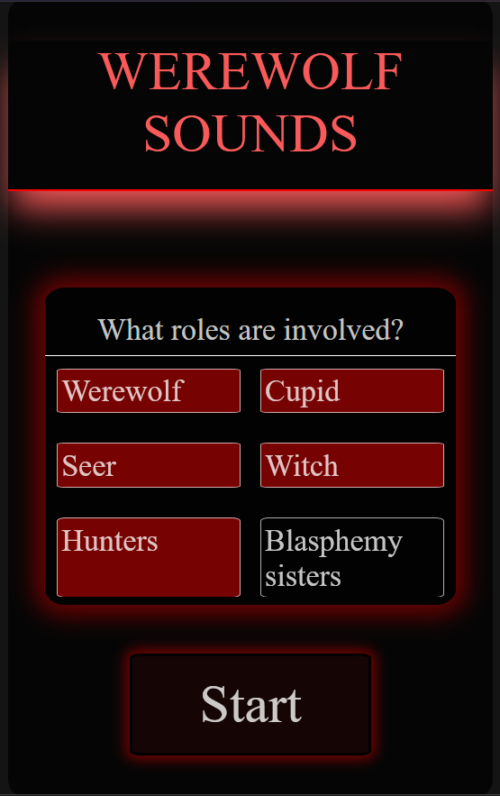

# werewolfGameSounds

A website where you can record or play sounds for the werewolf game. 

# Why I developed it

For my birthday I want to play the werewolf game in a great round, but we played it already many times, so I'm developing this website to give the game a little more flavour, whit these funny sounds. A friend of mine recorded already three, you can find in the Day Screen.

# How does it work?

It's very simple! On the Landing Page you choose the roles that are in the game and then click start.

On the Game Screen you will then see two areas: Day and Night. You can select them and when you toggle between them you will notice the Rounds are counting. On the Day Screen you habe sounds that are used at Day: 

 At the Night Screen sounds you need at night.
 
 
  I sorted them chronologically so you can just click along while playing. 

*The game is still in development so at the moment there are only sounds at the Day Screen and just tree last of the buttons work*

# How to run it

It's a website, so you could just click that link: 

[wereWolfGame](https://nelebohn07012010-ship-it.github.io/werewolfGameSounds/)
